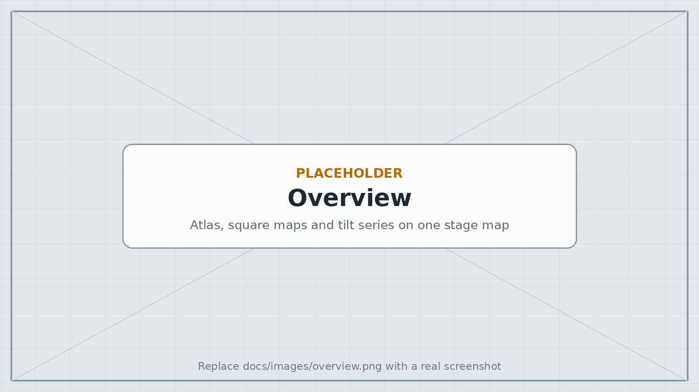
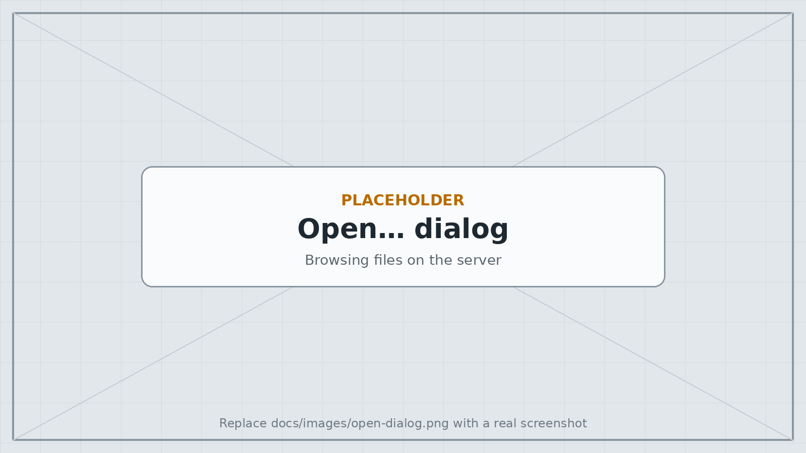
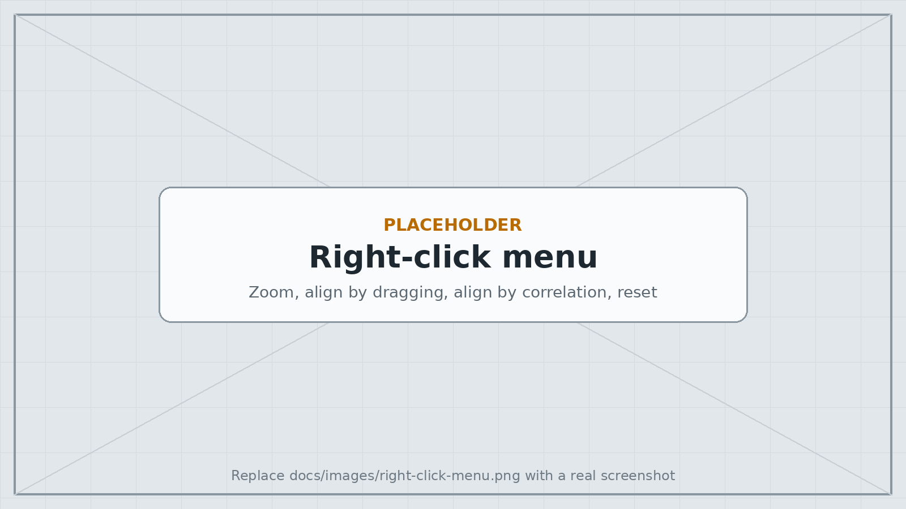
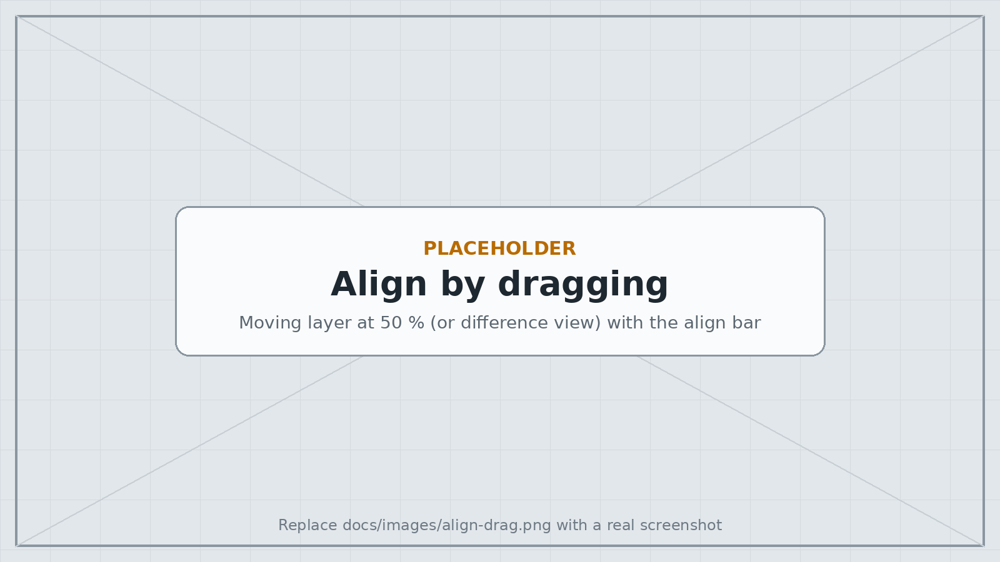
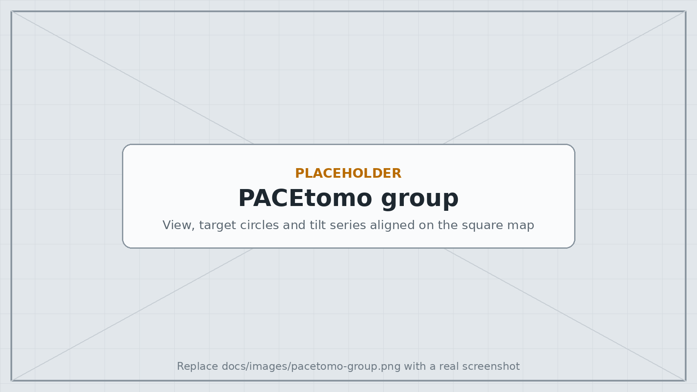
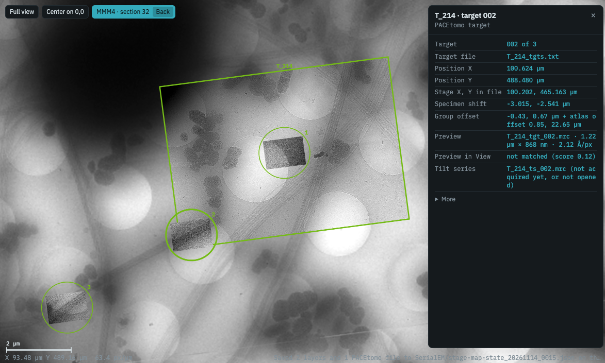
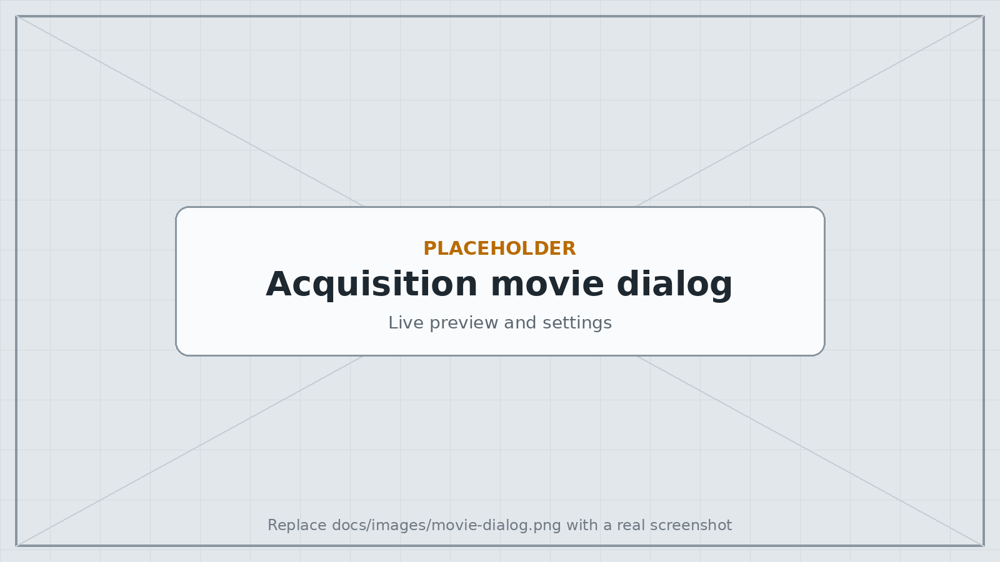
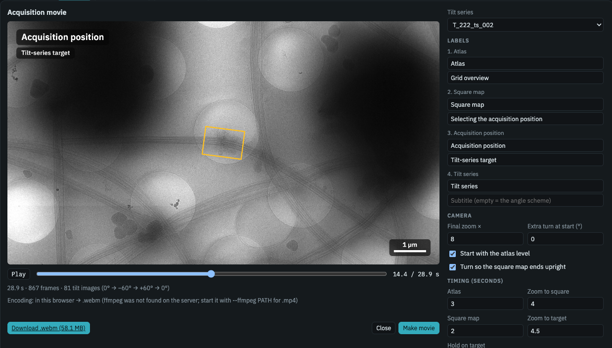
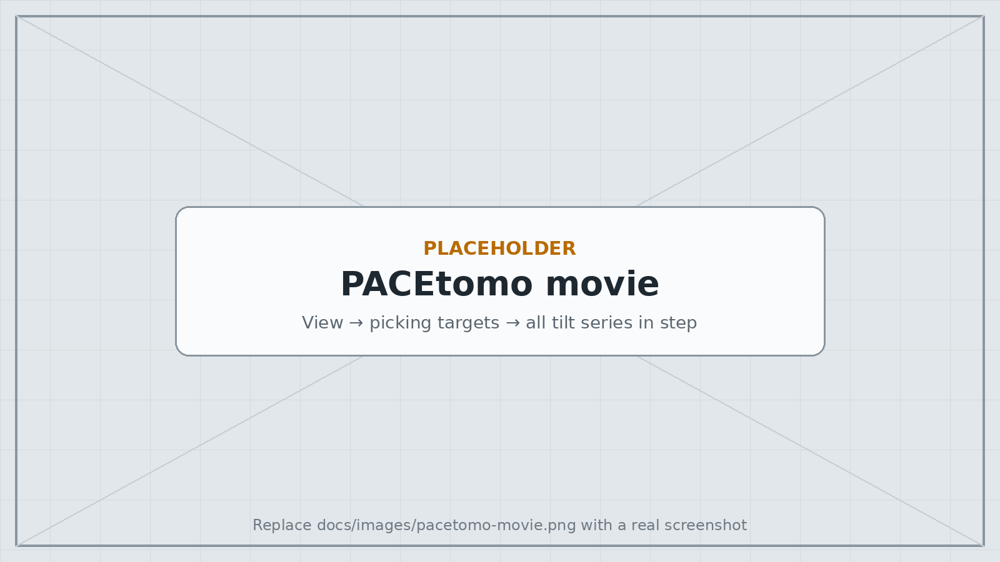

# SerialEM Grid Viewer (mdoc Stage Map)

<!-- Screenshots live in docs/images/. Replace each placeholder PNG with a real screenshot of the same name (1600×900 or any 16:9 size works). -->

A browser viewer for SerialEM sessions. It places the atlas, square maps, exposures, tilt series and PACEtomo targets from their `.mdoc` files on one stage map, lets you align them to each other, and makes an acquisition movie from atlas to tilt series.

It is one HTML page (`index.html`) plus a small Python server (`mdoc_server.py`) that serves your data folders to the browser.



## Contents

- [Quick start](#quick-start)
- [Opening data](#opening-data)
- [Aligning](#aligning)
- [PACEtomo](#pacetomo)
- [Details panel](#details-panel)
- [Acquisition movie](#acquisition-movie)
- [PACEtomo movie](#pacetomo-movie)
- [Sessions](#sessions)
- [Settings](#settings)
- [Keyboard and mouse](#keyboard-and-mouse)
- [Server options](#server-options)
- [Running on a remote workstation](#running-on-a-remote-workstation)
- [Requirements](#requirements)

## Quick start

On the remote computer that has the data. Organize the data this way

```text
SerialEMData/
├── atlas.mrc.mdoc                # Single grid atlas metadata
├── atlas.mrc                     # Single grid atlas
├── MMM1.mrc.mdoc
├── MMM1.mrc
├── ts/                           # Better to soft link all the .mrc files
│   ├── T_1_ts_001.mrc.mdoc
│   ├── T_1_ts_001.mrc            # Can be binned stack (.st is also ok)
│   ├── T_1_ts_002.mrc.mdoc
│   ├── T_1_ts_002.mrc
│   ├── T_1_ts_003.mrc.mdoc
│   └── T_1_ts_003.mrc
└── targets/
    ├── T_1_tgt_001_view.mrc.mdoc
    ├── T_1_tgt_001_view.mrc
    ├── T_1_tgt_001.mrc.mdoc
    ├── T_1_tgt_001.mrc
    ├── T_1_tgt_002.mrc.mdoc
    ├── T_1_tgt_002.mrc
    ├── T_1_tgt_003.mrc.mdoc
    ├── T_1_tgt_003.mrc
    └── T_1_tgts.txt
```

On the remote server where the data is, install serialEM_grid_viewer

```bash
git clone https://github.com/builab/serialEM_grid_viewer.git
cd serialEM_grid_viewer
```

Start the server on the remote workstation, listening only locally, and tunnel the port:

```bash
# on the workstation
python3 mdoc_server.py /path/to/your/serialEM/data --port 8765

# on your local computer do port forwarding like Cryosparc
ssh -N -f -L localhost:8765:localhost:8765 user@remote_server
```

Then open **http://localhost:8765** in Chrome, Edge or Firefox on your local machine.

Alternatively, if the data is on your local computer, then start on the local computer. Then open **http://localhost:8765** in browser.


## Opening data



- **Open…** opens `.mdoc` files of any type, and PACEtomo `_tgts.txt` files. The type (atlas, square map, exposure, tilt series) is detected from the mdoc. You can change it under a layer's **More**.
- When the page is served by `mdoc_server.py`, Open, Save and Load browse the **server**, not your own computer. A "Pick from this computer instead" link remains in each dialog.
- The **Data** box shows the server, its shared folders and the folders the open files came from.
- Each layer card shows its name, visibility, colour and **Show images**. Type, box rotation, piece alignment and sizes are under **More**.

## Aligning

All alignment is done from the **right-click menu** on the map. It lists actions for everything under the cursor.



| Right-click on | Actions |
|---|---|
| Square map | Zoom to this square · Align to atlas by dragging · Align to atlas by correlation · Reset atlas offset |
| Exposure or tilt series | Zoom to this image · Align by dragging · Align by correlation (shift only, or shift + rotation ±5°) · Refine the whole layer by correlation · Reset position · Make acquisition movie (tilt series) |
| PACEtomo View | Zoom to this View · Align by dragging · Align by correlation (shift only, or shift + rotation ±5°) · Refine targets inside the View · Find new tilt series · Reset alignment |
| PACEtomo target | Zoom to this target · Make acquisition movie |

**Align by dragging** opens an align bar. Drag anywhere on the map to move the item. What moves together:

- **Square map:** every square map, exposure, tilt series and PACEtomo area. This is one atlas offset.
- **PACEtomo View:** the View, all its targets and their tilt series.
- **Exposure or tilt series:** the image, plus any images that share its stage position.

While aligning, the moving images are drawn at 50 % opacity. Press **D** for a difference view, where features that line up go dark. Arrow keys nudge (Shift ×10), `[` and `]` rotate, **Enter** keeps the change and **Esc** cancels it. **Auto-refine** finishes with a correlation from where you dropped it.



**Align by correlation** matches the image against the square-map pieces read from the `.mrc`. A second pass runs at the pieces' own pixel size. The status line reports the score and the pixel size it matched at.

## PACEtomo



- Opening one `_tgts.txt` also opens its View image, the Preview image at each target, and every tilt series acquired so far. They form one group in the Layers list, with the tilt series nested under it.
- Each group has its own colour (bright yellow-green by default). Each target is drawn as a circle around its image.
- **View size:** if the View's pixel size in its mdoc disagrees with the square map, aligning by correlation also fits the View's size. The factor is remembered per magnification and reused for the next group. You can also set it by hand under the group's **More** ("View size ×").
- **Find new tilt series** picks up tilt series acquired after the file was opened.
- **Tilt series opened on their own** are recognized by name (the `tsfile` entries in the `_tgts.txt`), whenever and from whichever folder they are opened. They join the group and sit at their target.
- **A tilt series can be aligned on its own** (right-click it). It keeps its own position and stays part of the group; its target circle follows it.

## Details panel

Click any item to see its details. The short list comes first; the raw mdoc keys and file header are under **More**.

- **Square map and atlas:** file, centre X/Y, box size, image size, pixel size used, box rotation, atlas offset, fitted px → stage.
- **Exposure, tilt series and View:** the same, plus image shift and specimen shift. Tilt series also show angle from, to and increment.
- **PACEtomo target** (click inside its circle): target number, position, stage position in the file, specimen shift, Preview and how it matched in the View, and the tilt series with its angle range.



## Acquisition movie

Right-click a tilt series (or its PACEtomo target) and choose **Make acquisition movie…**. The movie goes atlas → square map → acquisition position → tilt series, using the positions as aligned in the viewer. No manual coordinates or blendmont-stitched montages are needed.



The dialog has a live preview (scrub or play) and these settings:

- **Labels:** a title and subtitle for each of the four stages. An empty title hides the label.
- **Camera:** final zoom, extra turn at the start, start with the atlas level, turn so the square map ends upright.
- **Timing:** seconds for the atlas, the zoom to the square, the square map, the zoom to the target, and the hold on the target.
- **Tilt playback:** start/end angle, lowest and highest angle, order (start → lowest → highest → start, or the reverse), images per second, and the stage-tilt schematic on or off. The start angle defaults to the first image acquired (from `DateTime`), so a lamella series starts at its pre-tilt.
- **Output:** 1280×720, 1920×1080 or 3840×2160, at 24, 30 or 60 frames per second.

For the movie, the square map is rebuilt as one image: every piece is re-read at higher resolution, with one contrast for the whole map and blended overlaps. The area around the target is added at full resolution. The atlas cross-fades into the square map during the zoom, and everything outside the square map is black from then on.



**Encoding.** With ffmpeg on the server machine, the server encodes an H.264 `.mp4`. You can download it or save it into a shared folder. Without ffmpeg, the browser encodes a `.webm` frame by frame. The dialog says which one it will use. Both give exactly the duration shown in the preview.

## PACEtomo movie

Right-click the View of a PACEtomo area and choose **Make PACEtomo movie…**. The movie goes:

1. Atlas → square map → zoom to the View.
2. Picking the targets one by one: a box at each tilt series, a circle drawn around it, and its number.
3. All tilt series in a grid, stepping through the tilt angles together.

The tilt series stand in for their targets, at their aligned positions. Targets without a tilt series are picked but left out of the grid. The playback uses the same bidirectional order as the acquisition movie (start → lowest → highest → start), not the dose-symmetric acquisition order.

The dialog has the same labels, camera, playback and output settings as the acquisition movie. The timing settings are the atlas, the zoom to the square, the square map, the zoom to the View, and the time per target.



## Sessions

**Save session…** writes a `.json` file with the open files, layer settings, view, atlas offset, aligned positions and PACEtomo alignments. With the server, it is saved in a shared folder. **Load session…** reopens everything from it. Positions are also kept in the browser between visits, and **Restore last session** brings back the previous one.

## Settings

The collapsed **Settings** section in the sidebar holds:

- **Atlas offset:** X/Y in µm, on or off, reset.
- **Alignment:** whether Auto-refine also fits rotation; whether images that share a stage position move together; use or clear aligned positions.
- **Image shift → stage:** µm per IS unit, IS rotation and invert IS Y. The box centre is `StagePosition + scale · R(θ) · (ISx, −ISy)`.
- **Display:** view rotation (180° matches the SerialEM Navigator), grid outline, labels, piece numbers, mirror stage Y.

## Keyboard and mouse

| Input | Action |
|---|---|
| Drag | Pan (while aligning: move the item) |
| Wheel | Zoom |
| Click | Select and show details; click a square map to zoom into it |
| Right-click | Menu for the items under the cursor |
| F or Esc | Full view |
| D | Toggle difference view for moving images |
| While aligning: arrows / Shift+arrows | Nudge by 1 / 10 screen pixels |
| While aligning: `[` `]` (Shift: ×10) | Rotate by 0.5° (5°) |
| While aligning: Space-drag or middle-drag | Pan |
| While aligning: Enter / Esc | Keep / cancel |

## Server options

```text
python3 mdoc_server.py ROOT [ROOT ...] [options]

  --port 8765          port to listen on
  --host 127.0.0.1     127.0.0.1 = this computer only (default); 0.0.0.0 = whole network
  --html PATH          the viewer page (default: index.html next to the script)
  --read-only          never write anything (no session files, no movies)
  --ffmpeg PATH        ffmpeg for movies: a path, 'auto' (default: look on PATH) or 'none'
  -v, --verbose        log every request
```

Only the folders you list are reachable. Everything is read-only, except session `.json` files and movie `.mp4` files saved inside those folders. Requests that write need a JSON content type, so a page from another website cannot make your browser write files there. At start-up the server prints the shared folders and whether it found ffmpeg.

## Requirements

- **Browser:** a current Chrome, Edge or Firefox. Encoding movies in the browser needs WebCodecs (Chrome or Edge).
- **Server:** Python 3.7 or newer.
  - Optional: `numpy`. The server then shrinks each image piece before sending it, which is much faster over a network.
  - Optional: `ffmpeg` on the server machine, for `.mp4` movies. `--ffmpeg` points at a specific binary; the copy from the `imageio-ffmpeg` Python package is also found.
- **Data:** SerialEM `.mdoc` files with their `.mrc` images. Little-endian MRC, modes 0, 1, 2, 6 and 12.

## License

GNU General Public License v3.0. See [LICENSE](LICENSE).

---

Vibecoded by [BuiLab@McGill](https://huy-bui.lab.mcgill.ca/).
